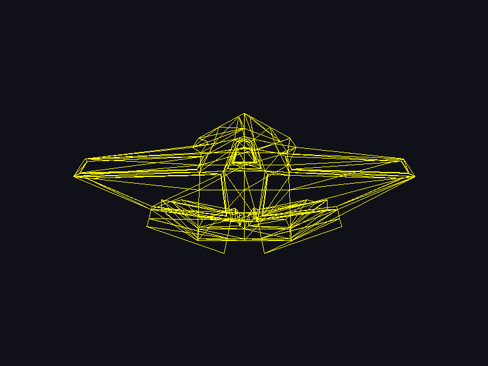

# Lab 4 – Carga de modelos

**Camila Sandoval – 24358**

Software renderer en Rust que carga un modelo `.obj` (la nave hecha en Blender en el lab anterior) y lo dibuja en pantalla con una función propia de triángulos. Se recorren las caras manualmente, se toman los índices de sus vértices y con esos tres vértices se dibuja cada triángulo.

## Render



## Cómo correrlo

```bash
cargo run
```

Se abre una ventana con el modelo centrado y se guarda la captura en `render.png`. `Esc` para salir.

## Estructura

- `assets/spaceship.obj` – modelo exportado de Blender
- `src/obj.rs` – lector del archivo `.obj` (vértices y caras)
- `src/triangle.rs` – líneas (Bresenham) y triángulos
- `src/framebuffer.rs` – framebuffer y guardado a PNG
- `src/main.rs` – proyección, centrado y render
